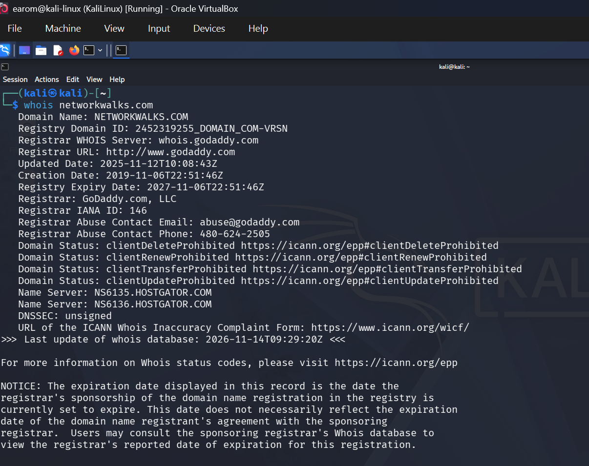
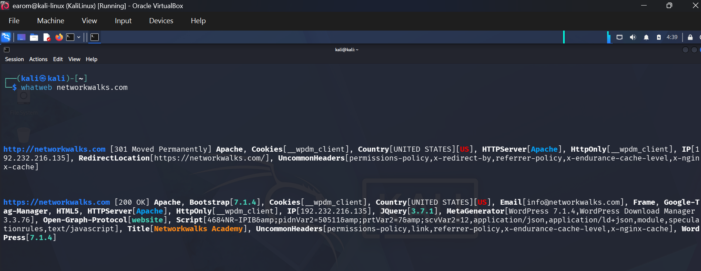
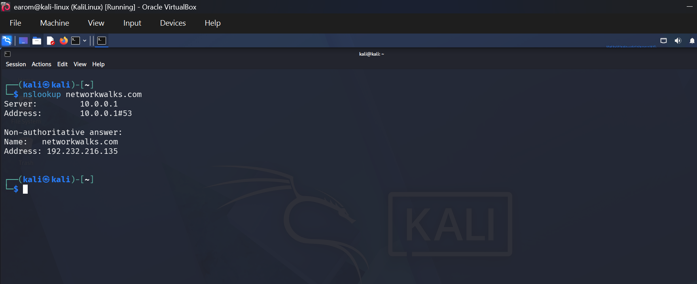
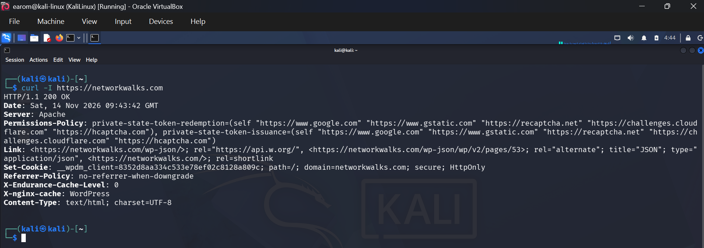
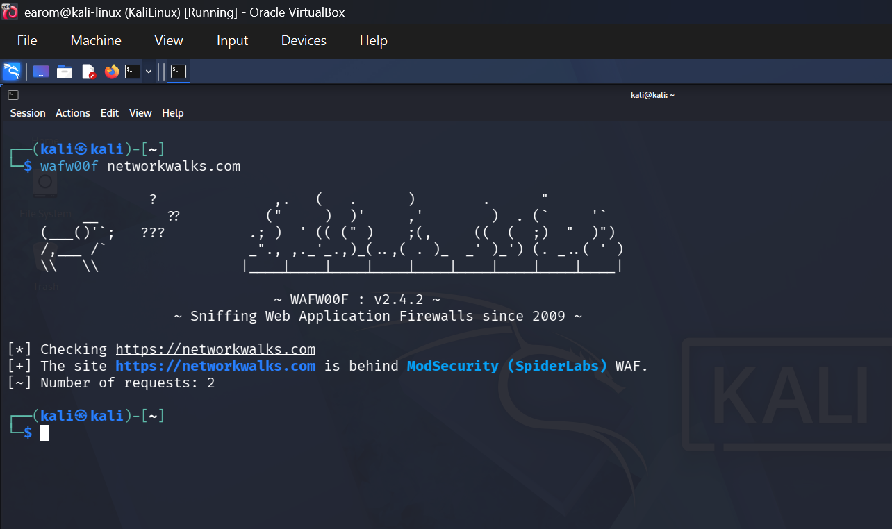
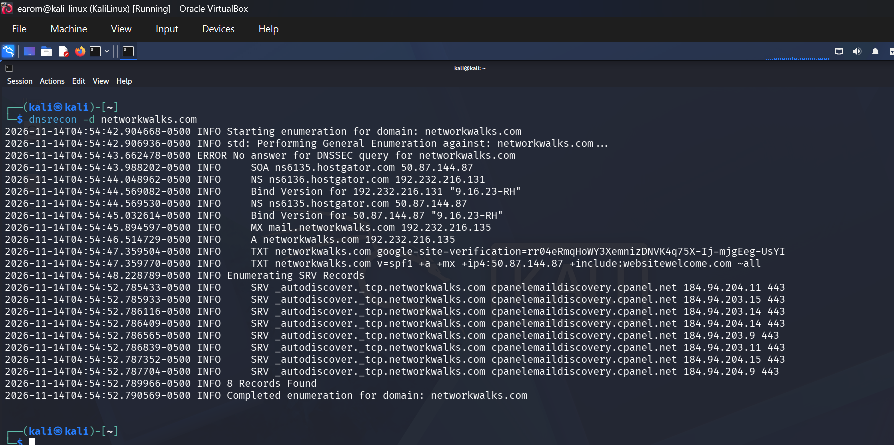
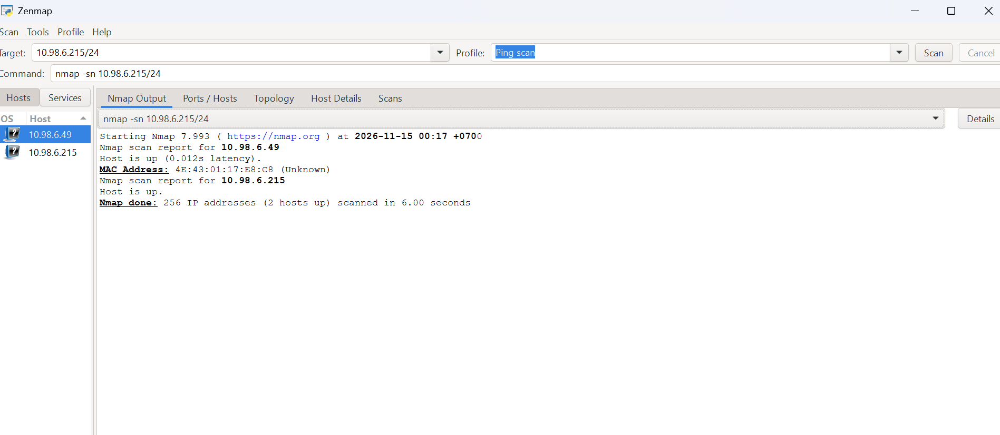
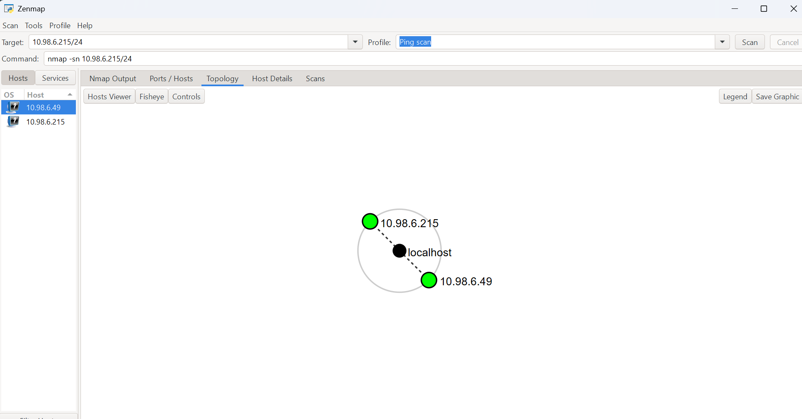

# Week 2 Penetration Testing Report — Footprinting & Network Discovery

**Prepared by:** Ezekiel Arom  
**Program:** Networkwalks Cybersecurity & Ethical Hacking Internship (B084)  
**Modules:** W2-PM1 (Reconnaissance), W2-PM5 (Zenmap)  
**Evidence dates:** 14–15 November 2026

## Project overview

This repository documents six Kali Linux footprinting tools applied to `networkwalks.com` and a Zenmap/Nmap ping scan of the local `10.98.6.0/24` network. It is an evidence-based educational report, **not a claim of successful exploitation or verified vulnerabilities**.

> **Authorization:** The supplied sample report states permission was secured for the domain and ownership of the local network. The underlying authorization document was not independently reviewed. Do not repeat tests without documented permission.

## Key results

| Tool | Command captured | Observation | Evidence |
|---|---|---|---|
| WHOIS | `whois networkwalks.com` | GoDaddy registrar, HostGator nameservers; DNSSEC unsigned | [Screenshot](screenshots/01-whois.png) |
| WhatWeb | `whatweb networkwalks.com` | HTTP redirect to HTTPS; Apache, WordPress 7.1.4, Bootstrap 7.1.4, jQuery 3.7.1, Download Manager 3.3.76 | [Screenshot](screenshots/02-Whatweb.png) |
| Nslookup | `nslookup networkwalks.com` | Resolved to 192.232.216.135 using resolver 10.0.0.1 | [Screenshot](screenshots/03-nslookup.png) |
| cURL | `curl -I https://networkwalks.com` | HTTP 200; Apache, REST API link, Secure/HttpOnly cookie and policy/cache headers | [Screenshot](screenshots/04-curl_-I.png) |
| WAFW00F | `wafw00f networkwalks.com` | ModSecurity (SpiderLabs) WAF fingerprint, heuristic result | [Screenshot](screenshots/05-wafw00f.png) |
| DNSRecon | `dnsrecon -d networkwalks.com` | NS, SOA, A, MX, TXT/SPF, SRV records; BIND 9.16.23-RH indicator | [Screenshot](screenshots/06-dnsrecon.png) |
| Zenmap host discovery | `nmap -sn 10.98.6.215/24` | Two hosts up: 10.98.6.49 and 10.98.6.215 (256 addresses scanned) | [Screenshot](screenshots/07-livehost.png) |
| Zenmap topology | `nmap -sn 10.98.6.215/24` | Topology graphic depicting two responding nodes | [Screenshot](screenshots/08-pingscan.png) |

## Evidence screenshots

### 1. WHOIS

**Command:** `whois networkwalks.com`



### 2. WhatWeb

**Command:** `whatweb networkwalks.com`



### 3. Nslookup

**Command:** `nslookup networkwalks.com`



### 4. cURL

**Command:** `curl -I https://networkwalks.com`



### 5. WAFW00F

**Command:** `wafw00f networkwalks.com`



### 6. DNSRecon

**Command:** `dnsrecon -d networkwalks.com`



### 7. Zenmap host discovery

**Command:** `nmap -sn 10.98.6.215/24`



### 8. Zenmap topology

**Command:** `nmap -sn 10.98.6.215/24`



## Findings and defensive recommendations

1. **Technology disclosure (review):** Verify actual CMS/plugin versions, maintain patches and reduce unnecessary banners. Fingerprinting does not establish a vulnerability.
2. **DNS/service exposure (review):** Audit NS, MX, SPF and autodiscover records, and remove obsolete entries.
3. **HTTP configuration (review):** Review response security headers and cookie controls against policy; a REST API link is not automatically a flaw.
4. **WAF detection (maintain):** Confirm WAF policy coverage and logging. Heuristic identification does not prove efficacy.
5. **LAN visibility (maintain):** Reconcile the two responding addresses with the authorized device inventory; nonresponding hosts may still exist.
6. **Domain protection (maintain):** Protect registrar access with MFA and assess DNSSEC deployment.

## Limitations

The supplied evidence documents information gathering and host discovery only. There is no evidence of port enumeration, authenticated assessment, vulnerability validation, exploitation or post-exploitation. DNS, hosting and software versions may change after the screenshot dates. Do not interpret these observations as confirmed vulnerabilities.

## Report

[Download the full PDF report](Networkwalks_Week2_Penetration_Testing_Report.pdf)

## Repository structure

```text
Networkwalks_Week2_GitHub/
├── README.md
├── Networkwalks_Week2_Penetration_Testing_Report.pdf
└── screenshots/
    ├── 01-whois.png
    ├── 02-Whatweb.png
    ├── 03-nslookup.png
    ├── 04-curl_-I.png
    ├── 05-wafw00f.png
    ├── 06-dnsrecon.png
    ├── 07-livehost.png
    └── 08-pingscan.png
```

**Source material:** Eight original screenshots, the supplied Networkwalks sample report, and the supplied W2-PM1 README draft. Documentation by Ezekiel Arom.
